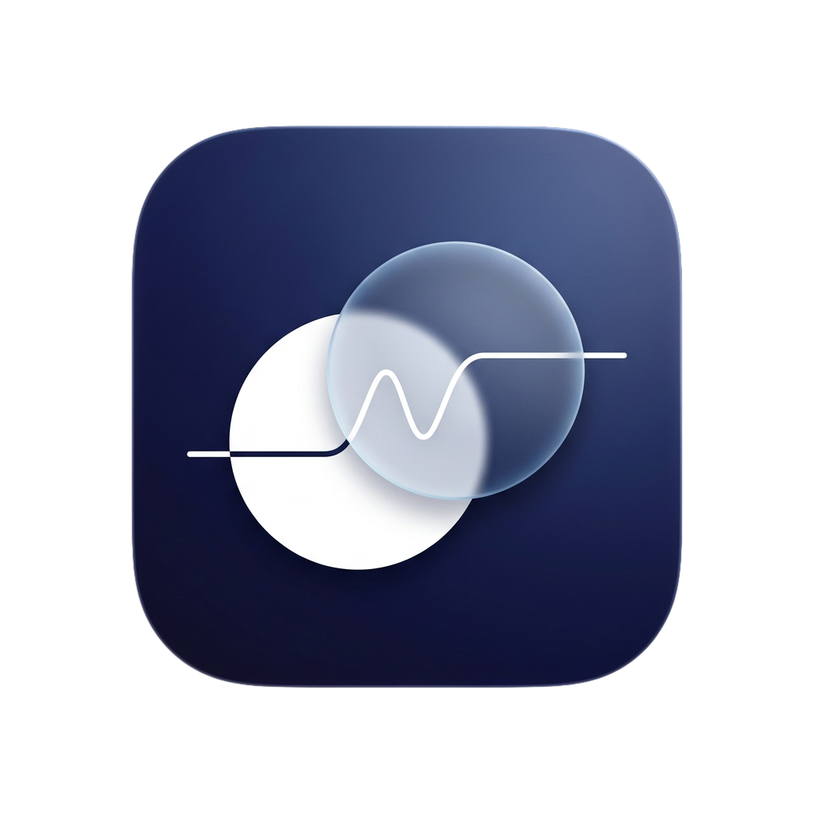
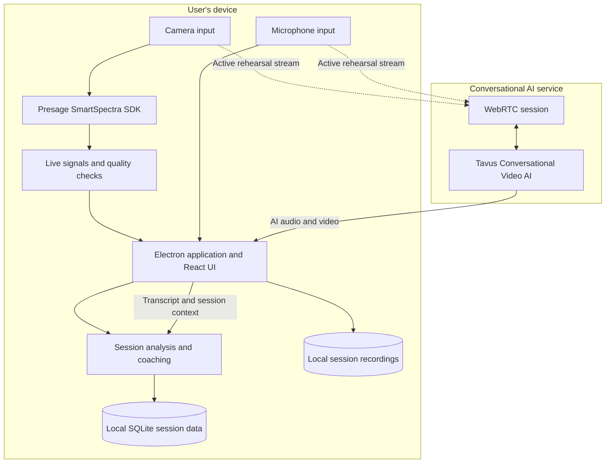

 <p align="center">
  
</p>

<h1 align="center">mocktwo</h1>

<p align="center">
  <strong>Practice the conversations that matter. Build composure under pressure.</strong>
</p>

<p align="center">
  An AI-powered conversation rehearsal application that combines realistic video roleplay with live, camera-based signals from Presage SmartSpectra.
</p>

<p align="center">
  <a href="https://github.com/shivam-chaturvedi/mocktwo">
    
  </a>
  <a href="https://dev.to/challenges/presage-2026-11-04">
    
  </a>
  <a href="https://www.tavus.io/">
    
  </a>
</p>

<p align="center">
  
  
  
  
  
  
</p>

<p align="center">
  
</p>

---

## Overview

The hardest conversations rarely follow a script. A client challenges a decision, a stakeholder pushes back, a customer threatens to leave, or an interviewer asks an unexpected question. Preparing the right words is only part of the challenge; delivering them clearly while under pressure is another.

**mocktwo helps people rehearse those moments.** Choose a scenario, meet an AI video counterpart powered by **Tavus**, and practise responding in a realistic, face-to-face conversation. During the rehearsal, **Presage SmartSpectra** analyses camera-derived physiological signals such as pulse. mocktwo then brings the conversation, recording, and measured signals together in a session review.

The goal is not to eliminate nervousness. It is to help people recognise how pressure affects them, understand the moments that change their response, and practise more deliberate communication.

## At a glance

| | |
|---|---|
| **Problem** | People need a realistic way to practise difficult conversations and reflect on how they respond under pressure. |
| **Approach** | AI-powered roleplay paired with live, camera-based physiological sensing. |
| **AI video** | Tavus Conversational Video Interface (CVI). |
| **Human sensing** | Presage SmartSpectra SDK. |
| **Primary live signal** | Pulse / heart rate, shown during rehearsal and reviewed against a calm baseline. |
| **Session review** | Synchronized recording, transcript, signal timeline, coaching feedback, and progress history. |
| **Application** | Electron desktop application with a React and TypeScript interface. |

## The experience

mocktwo is built around a simple practice loop:

1. **Calibrate.** Sit comfortably in front of the camera while SmartSpectra establishes a personal resting reference. Signal quality is checked before the baseline is used.
2. **Rehearse.** Have a live conversation with a Tavus AI counterpart. The counterpart responds to what you say, asks follow-up questions, and can challenge your position. Pulse information is available during the session.
3. **Review.** Explore the recording, transcript, and physiological timeline together. Identify moments of increased activation, see how your signals changed, and review practical coaching suggestions.

<p align="center">
  
</p>

## How mocktwo responds to human signals

This is the central SmartSpectra integration in mocktwo: the application uses a live signal from the person practising to make the rehearsal review more informative than a transcript or video replay alone.

### 1. Establish a personal baseline

Before a rehearsal, the user starts a guided calibration. SmartSpectra analyses the camera feed and establishes a resting reference, including pulse. The app checks signal quality so that poor lighting, movement, or an unsuitable camera position does not silently become a trusted baseline.

<p align="center">
  
</p>

### 2. Observe signals during the conversation

During a user-initiated rehearsal, SmartSpectra continues to provide camera-derived measurements. The live pulse indicator gives the user immediate context while they speak and listen to the AI counterpart.

<p align="center">
  
</p>

### 3. Connect signal changes to conversation moments

After the session, mocktwo plots the measured pulse against the calibrated resting reference. Significant rises can be highlighted as pressure events. The timeline is connected to the session transcript and recording, helping the user inspect what was being discussed around the time a signal changed.

<p align="center">
  
</p>

### 4. Turn the review into practice

The debrief combines measured signals with conversation context. It can highlight rushed responses, extended speaking turns, or moments worth reviewing, then suggest a practical drill for a future rehearsal.

<p align="center">
  
</p>

**Signal interpretation is contextual.** Pulse and other camera-derived indicators can be affected by lighting, movement, camera quality, and individual variation. mocktwo presents them as coaching signals, not as a diagnosis or a definitive measurement of someone's emotional state.

## Features

### Realistic AI conversation practice

- **Tavus AI video counterparts:** practise face-to-face with a conversational video persona.
- **Dynamic dialogue:** respond to follow-up questions, objections, and changing conversational context.
- **Workplace scenarios:** prepare for client escalations, difficult customer conversations, interviews, negotiations, management discussions, and executive presentations.
- **Persona choices:** practise with different counterpart styles and levels of conversational challenge.

### Live signal awareness

- **Calm baseline calibration:** establish a personal resting reference before practice.
- **Live pulse indicator:** view the current pulse signal during a rehearsal when signal quality is sufficient.
- **Signal-quality feedback:** understand when conditions are not suitable for reliable measurement.
- **Session analytics:** review pulse, HRV-related metrics, breathing information, blink activity, and other available session indicators where supported by the captured data.

### Evidence-led session debrief

- **Pressure timeline:** inspect pulse changes over the course of a rehearsal.
- **Transcript-linked review:** move between conversation moments and the corresponding section of the recording.
- **Session playback:** review the rehearsal recording after the conversation.
- **Coaching feedback:** identify communication patterns such as rushed speech, filler words, defensive answers, or unclear responses.
- **Personalised drills:** use targeted exercises to practise a specific behaviour in the next session.

### Progress and customisation

- **Session archive:** revisit previous rehearsals and compare results over time.
- **Progress analytics:** review trends across 7-day, 30-day, 90-day, and all-time periods.
- **Pressure-skill breakdown:** track Composure, Recovery, Pulse Control, Autonomic Balance, and Expression Calm as product-defined coaching indicators.
- **Scenario and persona customisation:** tailor practice situations and counterpart characteristics to the conversations that matter.

<p align="center">
  
</p>

## Composure scoring

mocktwo includes a product-defined **Composure Score** to make session feedback easier to understand. It combines two parts of the rehearsal:

- **Pulse control (60%):** how much the pulse rose compared with the user's calibrated resting reference.
- **Recovery (40%):** how long it took the pulse to move back towards that reference after a flagged rise.

The application also groups results into descriptive feedback bands such as Calm, Mild, Moderate, and High. These labels are intended to support reflection and practice. They are **not clinical categories, validated medical thresholds, or a measure of someone's fitness for a job or role**.

## System architecture

The application keeps physiological analysis separate from the live AI conversation path. This distinction is important: camera frames used by SmartSpectra for physiological analysis are processed locally, while the user knowingly shares live camera and microphone streams with the conversational AI service during an active rehearsal.



### Technology stack

| Layer | Technology | Purpose |
|---|---|---|
| Desktop runtime | Electron | Application shell and desktop capabilities |
| User interface | React, TypeScript, Vite | Interactive application interface |
| Human-sensing | Presage SmartSpectra SDK | Camera-based physiological signals and signal-quality information |
| Conversational AI | Tavus CVI | Real-time AI video counterpart |
| Real-time media | Daily WebRTC integration | Live audio/video session transport |
| Local persistence | SQLite (`better-sqlite3`) | Session records and structured local data |
| Visualisation | Recharts | Session analytics and signal timelines |

## Privacy, consent, and data handling

Camera-derived physiological information and rehearsal conversations are personal. mocktwo separates local signal analysis from the media stream required for an AI conversation.

| Data / activity | How mocktwo handles it |
|---|---|
| **Camera permission** | Camera access is requested through the application and operating-system permission flow for user-initiated calibration or rehearsal. Monitoring is not intended to run covertly in the background. |
| **Microphone permission** | Microphone access is requested for an active conversation and related speech analysis. |
| **SmartSpectra processing** | Camera frames used for physiological measurement are processed locally in memory. Those analysis frames are not saved as recordings or sent to Presage by the physiological measurement path. |
| **SmartSpectra telemetry** | The project configuration sets `SMARTSPECTRA_TELEMETRY=false`. |
| **Tavus AI service** | During an active AI rehearsal, the user's camera video and microphone audio are transmitted through the WebRTC session so the AI counterpart can see and hear the user and respond. This is separate from the local physiological analysis path. |
| **Physiological measurements** | Session measurements and derived analytics are stored locally for review. They are not sent to Tavus as part of the AI conversation. |
| **Transcripts and recordings** | Session records, transcripts, and recordings are stored locally on the user's device. mocktwo does not use cloud synchronization for this session archive. |
| **Deletion** | Users can delete saved sessions and their associated local recordings and data from the application. |

### Important distinction about video sharing

**Local biometric processing does not mean that no video ever leaves the device.** When a user starts a Tavus rehearsal, the camera and microphone streams are shared with the conversational service over WebRTC. The separate SmartSpectra analysis path processes the camera frames locally for physiological measurements. This distinction should be understood before granting camera and microphone access.

### Responsible-use statement

mocktwo is an educational and professional-development tool for conversation practice. It is not a medical device and does not diagnose, treat, monitor, or prevent any medical condition. Its scores and physiological indicators are not intended for clinical decisions, hiring decisions, employee evaluation, or other high-stakes decisions about people. Use them as personal coaching feedback, alongside your own judgement.

## Getting started

### Requirements

- Node.js 20 or later.
- npm.
- A webcam and microphone.
- A Presage SmartSpectra API key.
- A Tavus API key for live AI video conversations.

### 1. Clone the repository

```bash
git clone https://github.com/shivam-chaturvedi/mocktwo.git
cd mocktwo
```

### 2. Install dependencies

```bash
npm install
```

### 3. Configure environment variables

Create a local environment file from the example:

```bash
cp .env.example .env
```

Add your credentials to `.env`:

```env
TAVUS_API_KEY=your_tavus_api_key
SMARTSPECTRA_API_KEY=your_presage_smartspectra_api_key
SMARTSPECTRA_TELEMETRY=false
```

Keep these credentials in the main-process environment. Do not rename them with a `VITE_` prefix, commit `.env`, or expose secret keys in client-side code. The repository's `.env.example` contains the available configuration options.

- Create or manage a Presage API key through the [Presage developer portal](https://physiology.presagetech.com/auth/register).
- Learn about the conversational video service at [Tavus](https://www.tavus.io/).

### 4. Run the application

```bash
npm run dev
```

Grant camera and microphone access when prompted. Complete the baseline calibration before starting a rehearsal so the session can be compared with a personal resting reference.

## Development commands

| Command | Description |
|---|---|
| `npm run dev` | Start the application in development mode |
| `npm run build` | Type-check and build the renderer |
| `npm run lint` | Run Oxlint on the application source |
| `npm test` | Run the automated test suite |
| `npm run dist` | Build a distributable package for the current build environment |
| `npm run dist:mac` | Build the configured arm64 macOS distribution |

The packaging configuration also defines Windows installer and Linux AppImage targets. Actual distribution should be validated on the intended operating system and architecture, including the availability of the matching SmartSpectra SDK package.

## Keyboard shortcuts

| Action | macOS | Windows / Linux |
|---|---|---|
| Open search / command palette | `⌘ K` | `Ctrl + K` |
| Open quick practice | `⌘ ⇧ P` | `Ctrl + Shift + P` |
| Open settings | `⌘ ,` | `Ctrl + ,` |
| Go to dashboard | `⌘ 1` | `Ctrl + 1` |
| Open scenarios | `⌘ 2` | `Ctrl + 2` |
| Open recordings | `⌘ 3` | `Ctrl + 3` |
| Open progress | `⌘ 4` | `Ctrl + 4` |
| Close a modal or sheet | `Esc` | `Esc` |
| Toggle microphone during rehearsal | `M` | `M` |
| Toggle camera during rehearsal | `V` | `V` |
| End active rehearsal | `Esc` / `⌘ W` | `Esc` / `Ctrl + W` |

## Troubleshooting

**SmartSpectra signal quality is poor**

Use even, front-facing light; keep your face within the camera frame; and minimise movement during calibration. Wait for the app to indicate that the signal is suitable before relying on a measurement. Do not interpret missing or low-quality readings as a zero response.

**The camera or microphone is unavailable**

Check the operating system's privacy settings and make sure mocktwo has permission to access the relevant device. Close other applications that may be holding exclusive access to the camera or microphone, then restart the rehearsal.

**The AI counterpart does not connect**

Check that `TAVUS_API_KEY` is set correctly in `.env`, that the key is active, and that the device has a working internet connection. Tavus conversations require network access.

**SmartSpectra does not initialise**

Check that `SMARTSPECTRA_API_KEY` is set correctly and that the SDK package for the current platform is installed and available. Review the terminal output for configuration or SDK initialisation errors.

## Project structure

```text
mocktwo/
├── electron/                 # Electron main process, preload, storage, and AI session code
│   ├── storage/              # Local persistence and database worker
│   └── tavus/                # Tavus conversation integration
├── src/                      # React and TypeScript application
│   ├── components/            # Shared interface components
│   ├── hooks/                # Camera, microphone, and application hooks
│   ├── screens/               # Main application screens
│   ├── services/              # SmartSpectra, session, and analytics services
│   ├── types/                 # Application and IPC types
│   └── utils/                 # Scoring, coaching, and utility logic
├── tests/                     # Automated tests
├── scripts/                   # Development and build scripts
├── docs/                      # Project documentation
├── .env.example               # Environment configuration template
└── README.md
```

## Security practices

The application is designed with a separated Electron main and renderer process:

- Renderer Node.js integration is disabled.
- Context isolation is enabled.
- Renderer access to privileged functionality is exposed through a scoped preload bridge.
- IPC messages are validated before privileged operations are performed.
- Content Security Policy restrictions are used to reduce unwanted script execution.
- Local recording playback uses an application-defined protocol with path validation.
- API credentials are kept out of the renderer-facing environment.

## Challenge context

mocktwo was built for the [**Presage SmartSpectra SDK Challenge**](https://dev.to/challenges/presage-2026-11-04). The challenge asks developers to create a functional experience that responds meaningfully to real-time human signals captured through a camera.

The project focuses on a practical use case: helping people practise difficult conversations and reflect on how their physiological signals change during those interactions. The public repository and setup instructions are provided here so the SmartSpectra integration can be reviewed.

For the challenge submission, the accompanying demo should visibly show:

1. The user initiating camera access and completing baseline calibration.
2. A live SmartSpectra signal, such as pulse, updating during a rehearsal.
3. A conversation with the Tavus AI counterpart.
4. The post-session timeline connecting signal changes with the conversation recording or transcript.

> **Demo video:** Add the public demo video URL here before submitting the challenge entry. The video is a required challenge submission item and should clearly show a live Presage signal in action.

### Final challenge checklist

- [ ] Publish the individual submission post on DEV using the official challenge template and the `#presagechallenge` tag.
- [ ] Link this public repository and include the setup instructions.
- [ ] Add the public demo video URL and make sure the live Presage signal is clearly visible.
- [ ] Include the consent and data-handling explanation in the DEV post, including the separate Tavus media stream.
- [ ] State any applicable prize category or categories in the DEV post.
- [ ] Optional: upload an agent-session transcript, review it for secrets, and make it public before embedding it.

The DEV submission post is a separate requirement from this repository README. Use the [official submission template](https://dev.to/challenges/presage-2026-11-04) when publishing it.

## Acknowledgements

- [**Presage Technologies**](https://presagetech.com/) for the SmartSpectra human-sensing SDK.
- [**Tavus**](https://www.tavus.io/) for Conversational Video AI.
- [**Electron**](https://www.electronjs.org/) for the desktop application runtime.
- [**React**](https://react.dev/) and [**TypeScript**](https://www.typescriptlang.org/) for the application interface and type-safe development.

---

<p align="center">
  Built by <a href="https://github.com/shivam-chaturvedi">Shivam Chaturvedi</a>
</p>

<p align="center">
  <sub>mocktwo is for learning and communication practice. It is not a medical or diagnostic product.</sub>
</p>
