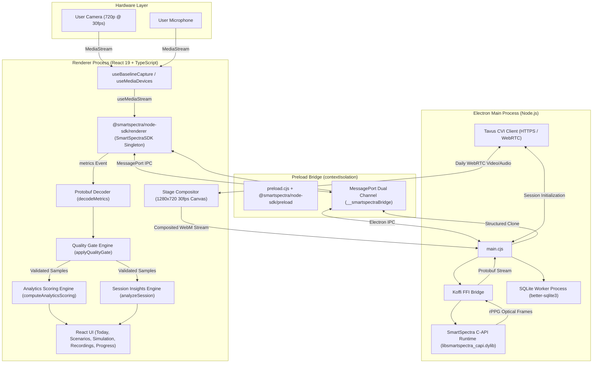

# Technical Architecture & Mathematical Formulas

> **mocktwo (Hotel Coach)** — High-Stakes Conversational Rehearsal & Composure Training Engine  
> Complete technical reference for the Presage SmartSpectra SDK Hackathon.

---

## 1. System Architecture & End-to-End Execution Flow

mocktwo is built as a sandboxed Electron desktop application with strict process isolation, native C++ FFI bindings, asynchronous worker-thread database persistence, real-time audio/video compositing, and on-device optical photoplethysmography (rPPG).

---

## 2. SmartSpectra Integration Details

### 2.1 Package & Versioning
- **Official Package**: `@smartspectra/node-sdk`
- **Installed Version**: `3.5.0`
- **Native Platform Binary**: `@smartspectra/node-sdk-darwin-arm64` / `@smartspectra/node-sdk-darwin-x64`
- **FFI Library**: `libsmartspectra_capi.dylib` (macOS), `smartspectra_capi.dll` (Windows), `libsmartspectra_capi.so` (Linux)
- **Transport**: Electron `MessageChannel` / `MessagePortMain` bridging the renderer main world to Node.js FFI without transferring raw `ArrayBuffer` objects (avoiding Electron drop bugs).

### 2.2 Lifecycle & Singleton Architecture
In [src/services/vitals/presageSession.ts](file:///Users/shivam/work/hotel-coach/src/services/vitals/presageSession.ts):
- **Singleton Guarantee**: The application instantiates exactly **one** `SmartSpectraSDK` instance across the lifecycle of the BrowserWindow.
- **Asynchronous Promise Queue**: All operations (`start`, `stop`, `reset`) are serialized through `enqueueOperation<T>()` to eliminate concurrency hazards during rapid user navigation.
- **Instance Reuse**: On session completion or error, `sdk.stop()` or `sdk.reset()` is invoked. The underlying native C-API context is preserved, avoiding expensive reconstruction latencies.
- **Global Teardown**: `destroySharedSdk()` is registered with `mediaLifecycle.ts` to cleanly free C-API memory when the application window closes.

### 2.3 Signals Subscribed & Consumed
mocktwo selectively requests and consumes the following physiological and facial channels:

| Metric Channel | Protobuf Identifier | Consumed Fields | Usage in mocktwo |
| :--- | :--- | :--- | :--- |
| **Pulse Rate** | `cardio.pulseRate` | `value` (bpm), `confidence`, `stable` | Real-time heart rate curve, peak spike detection, pulse control scoring. |
| **HRV RMSSD** | `cardio.hrv` | `rmssd` (ms), `confidence`, `stable` | Autonomic parasympathetic nervous balance ($\ge 60\text{s}$ windows). |
| **HRV Baevsky** | `cardio.hrv` | `baevsky` (unitless index), `deltaVsBaseline` | Stress index comparing current sympathetic tone to calm baseline. |
| **Breathing Rate** | `breathing.rate` | `value` (br/min), `confidence`, `stable` | Respiratory tracking during non-speaking conversational pauses. |
| **EDA Arousal** | `eda.trace` | `value` ($\mu\text{S}$), `timestamp` | Electrodermal sympathetic tone timeline plotting. |
| **Blinking** | `face.blinking` | `detected` (boolean), `timestamp` | Blink frequency (blinks/min) as an indicator of cognitive load. |
| **Speaking** | `face.talking` | `detected` (boolean), `timestamp` | Speaking share ratio and artifact gating for respiratory rates. |
| **Micro-Expressions** | `face.expression` | 8 emotion confidence scores (0.0 to 1.0) | Facial composure distribution (Neutral, Fear, Contempt, Surprise, etc.). |

---

## 3. Mathematical Formulas & Signal Processing

Every formula documented below is implemented directly in the production codebase.

---

### Formula 1: Quality Gate Verification
- **Source File**: [src/services/vitals/metrics.ts](file:///Users/shivam/work/hotel-coach/src/services/vitals/metrics.ts#L120-L163)
- **Function**: `applyQualityGate(sample)`

#### Mathematical Expression
$$\text{isValidationOk} = (\text{code} = 0 \lor \text{code} = \text{null})$$

$$\text{pulseValid} = \text{isValidationOk} \land (\text{pulse} \in [30, 220]) \land (C_{\text{pulse}} \ge 40) \land (\text{stable}_{\text{pulse}} = \text{true})$$

$$\text{breathingValid} = \text{isValidationOk} \land (\text{breathing} \in [4, 50]) \land (C_{\text{breathing}} \ge 45) \land (\text{stable}_{\text{breathing}} = \text{true})$$

$$\text{hrvValid} = \text{isValidationOk} \land (\text{RMSSD} > 0) \land (C_{\text{hrv}} \ge 50) \land (\text{stable}_{\text{hrv}} = \text{true})$$

$$\text{sampleValid} = \text{pulseValid} \lor \text{breathingValid} \lor \text{hrvValid}$$

#### Variables & Units
- $\text{code}$: Native SmartSpectra validation status code (0 represents `kOk`; non-zero indicates optical occlusion, motion, or multi-face errors).
- $\text{pulse}$: Instantaneous optical pulse in beats per minute (bpm).
- $C_{\text{pulse}}, C_{\text{breathing}}, C_{\text{hrv}}$: Confidence percentages ($0 - 100$).
- $\text{stable}$: Boolean convergence flag emitted by SmartSpectra signal Kalman filters.

#### Practical Numerical Example
Suppose a frame emits $\text{code} = 0$, $\text{pulse} = 74.2\text{ bpm}$, $C_{\text{pulse}} = 88$, $\text{stable}_{\text{pulse}} = \text{true}$.
- $\text{isValidationOk} = \text{true}$
- $74.2 \in [30, 220] \implies \text{true}$
- $88 \ge 40 \implies \text{true}$
- $\text{pulseValid} = \text{true} \implies$ sample accepted into analytical scoring arrays.

---

### Formula 2: Debounced Blink Edge Counter
- **Source File**: [src/services/vitals/metrics.ts](file:///Users/shivam/work/hotel-coach/src/services/vitals/metrics.ts#L168-L190)
- **Function**: `countBlinkEdges(blinks, debounceMs = 200)`

#### Mathematical Expression
Given a time-sorted sequence of boolean detections $B = \{(t_1, d_1), (t_2, d_2), \dots, (t_m, d_m)\}$:

$$\Delta E_k = 1 \iff (d_k = \text{true} \land d_{k-1} = \text{false} \land (t_k - t_{\text{last\_edge}}) \ge T_{\text{debounce}})$$

$$\text{BlinkCount} = \sum_{k=1}^{m} \Delta E_k$$

$$\text{BlinkRate} = \frac{\text{BlinkCount}}{\Delta T_{\text{minutes}}}$$

#### Variables & Units
- $t_k$: Microsecond epoch timestamps ($\mu\text{s}$).
- $T_{\text{debounce}}$: Refractory debouncing window ($200\text{ ms} = 200{,}000\mu\text{s}$) preventing double-counting eyelid flutter.
- $\text{BlinkRate}$: Blinks per minute.

---

### Formula 3: Stable Facial Expression Distribution
- **Source File**: [src/services/vitals/metrics.ts](file:///Users/shivam/work/hotel-coach/src/services/vitals/metrics.ts#L195-L247)
- **Function**: `averageExpressions(expressions)`

#### Mathematical Expression
For each emotion category $e \in \{\text{NEUTRAL}, \text{FEAR}, \text{CONTEMPT}, \text{SURPRISE}, \text{HAPPY}, \text{SAD}, \text{ANGRY}, \text{DISGUST}\}$ across $N_e$ stable frames:

$$\bar{C}_e = \frac{1}{N_e} \sum_{i=1}^{N_e} \text{clamp}(0, 1, c_{e,i})$$

$$\text{DominantExpression} = \arg\max_{e \neq \text{NEUTRAL}} (\bar{C}_e) \quad \text{if } \max(\bar{C}_e) > 0.15 \text{ else } \text{NEUTRAL}$$

#### Interpretation
Separates baseline composure (high $\bar{C}_{\text{NEUTRAL}}$) from autonomic leakage under cross-examination (elevated $\bar{C}_{\text{FEAR}}$ or $\bar{C}_{\text{CONTEMPT}}$).

---

### Formula 4: Baseline Quality Score
- **Source File**: [src/services/vitals/metrics.ts](file:///Users/shivam/work/hotel-coach/src/services/vitals/metrics.ts#L299-L332)
- **Function**: `computeQualityScore(params)`

#### Mathematical Expression
If $R_{\text{face}} < 0.30$, $\text{QualityScore} = 0$. Otherwise:

$$\text{BaseCoverage} = (R_{\text{face}} \times 40) + (R_{\text{pulse\_valid}} \times 35) + (R_{\text{breathing\_valid}} \times 25)$$

$$\text{Penalty} = (R_{\text{motion}} \times 30) + (R_{\text{talking}} \times 20)$$

$$\text{QualityScore} = \text{clamp}(0, 100, \text{round}(\text{BaseCoverage} - \text{Penalty}))$$

#### Variables & Units
- $R_{\text{face}}$: Proportion of calibration window with face detected ($0.0 - 1.0$).
- $R_{\text{pulse\_valid}}$: Ratio of quality-gated pulse samples.
- $R_{\text{breathing\_valid}}$: Ratio of quality-gated respiratory samples.
- $R_{\text{motion}}$: Proportion of frames flagged with `kExcessiveMotion` (code 12).
- $R_{\text{talking}}$: Proportion of frames with active speech during resting baseline.

#### Practical Numerical Example
Suppose $R_{\text{face}} = 0.95$, $R_{\text{pulse\_valid}} = 0.90$, $R_{\text{breathing\_valid}} = 0.80$, $R_{\text{motion}} = 0.05$, $R_{\text{talking}} = 0.00$:
$$\text{BaseCoverage} = (0.95 \times 40) + (0.90 \times 35) + (0.80 \times 25) = 38.0 + 31.5 + 20.0 = 89.5$$
$$\text{Penalty} = (0.05 \times 30) + (0.00 \times 20) = 1.5$$
$$\text{QualityScore} = \text{round}(89.5 - 1.5) = 88 \quad (\text{Excellent baseline quality})$$

---

### Formula 5: EDA Linear Regression Slope
- **Source File**: [src/services/vitals/metrics.ts](file:///Users/shivam/work/hotel-coach/src/services/vitals/metrics.ts#L337-L358)
- **Function**: `computeLinearSlope(points)`

#### Mathematical Expression
$$\beta = \frac{n \sum_{i=1}^{n} (x_i y_i) - \left(\sum_{i=1}^{n} x_i\right)\left(\sum_{i=1}^{n} y_i\right)}{n \sum_{i=1}^{n} x_i^2 - \left(\sum_{i=1}^{n} x_i\right)^2}$$

#### Interpretation
Measures whether sympathetic electrodermal conductance is climbing ($\beta > 0$) or de-escalating ($\beta < 0$) over the session.

---

### Formula 6: Pulse Control Score
- **Source File**: [src/utils/analyticsScoring.ts](file:///Users/shivam/work/hotel-coach/src/utils/analyticsScoring.ts#L69-L96)
- **Function**: `computeAnalyticsScoring(samples, baseline, durationSeconds)`

#### Mathematical Expression
$$\Delta\text{Pulse} = \max(0, \text{PeakPulse} - \text{RestingPulse}_{\text{baseline}})$$

$$S_{\text{pulse}} = \max(40, \min(100, \text{round}(100 - \Delta\text{Pulse} \times 2.2)))$$

#### Variables & Units
- $\text{PeakPulse}$: Maximum quality-gated heart rate observed during simulation (bpm).
- $\text{RestingPulse}_{\text{baseline}}$: User's calibrated resting heart rate (bpm).
- $\Delta\text{Pulse}$: Cardiovascular elevation above resting state (bpm).
- Factor $2.2$: Penalizes $2.2$ points per beat of elevation, scaling $\Delta\text{Pulse} \ge 27\text{ bpm}$ to the score floor of 40.

#### Practical Numerical Example
Resting baseline $= 72\text{ bpm}$. Peak pulse during tough cross-examination $= 81\text{ bpm}$.
$$\Delta\text{Pulse} = 81 - 72 = 9\text{ bpm}$$
$$S_{\text{pulse}} = 100 - (9 \times 2.2) = 100 - 19.8 = 80.2 \implies 80\%$$

---

### Formula 7: Autonomic Recovery Latency & Score
- **Source File**: [src/utils/analyticsScoring.ts](file:///Users/shivam/work/hotel-coach/src/utils/analyticsScoring.ts#L71-L103)
- **Function**: `computeAnalyticsScoring(samples, baseline, durationSeconds)`

#### Mathematical Expression
Let $t_{\text{peak}}$ be the timestamp of $\text{PeakPulse}$. The recovered sample timestamp $t_{\text{recovered}}$ satisfies:
$$t_{\text{recovered}} = \min \{ t \mid t \ge t_{\text{peak}} \land \text{Pulse}(t) \le (\text{RestingPulse}_{\text{baseline}} + 5) \}$$

$$T_{\text{recovery}} = \max(0, \text{round}((t_{\text{recovered}} - t_{\text{peak}}) / 1000)) \quad [\text{seconds}]$$

$$S_{\text{recovery}} = \max(40, \min(100, \text{round}(100 - \max(0, T_{\text{recovery}} - 12) \times 2.0)))$$

#### Variables & Units
- $T_{\text{recovery}}$: Stabilization latency in seconds.
- $+5\text{ bpm}$: Resting boundary envelope. Returning within 5 bpm of calm baseline confirms autonomic vagal reactivation.
- $12\text{s}$: Standard physiological lag floor. Recoveries under 12 seconds receive full marks ($100\%$).
- Factor $2.0$: Penalizes 2 points for every additional second of autonomic lag beyond 12s.

#### Practical Numerical Example
Peak pulse occurred at $t = 42\text{s}$. Pulse returned to $77\text{ bpm}$ (within $72 + 5$) at $t = 56\text{s}$.
$$T_{\text{recovery}} = 56 - 42 = 14\text{ seconds}$$
$$S_{\text{recovery}} = 100 - \max(0, 14 - 12) \times 2.0 = 100 - (2 \times 2.0) = 96\%$$

---

### Formula 8: Composite Composure Score
- **Source File**: [src/utils/analyticsScoring.ts](file:///Users/shivam/work/hotel-coach/src/utils/analyticsScoring.ts#L104-L111)

#### Mathematical Expression
$$S_{\text{composure}} = \begin{cases} 
\text{round}(S_{\text{pulse}} \times 0.60 + S_{\text{recovery}} \times 0.40) & \text{if } S_{\text{recovery}} \neq \text{null} \\
S_{\text{pulse}} & \text{if session ended before recovery}
\end{cases}$$

#### Practical Numerical Example
Using $S_{\text{pulse}} = 80\%$ and $S_{\text{recovery}} = 96\%$:
$$S_{\text{composure}} = \text{round}(80 \times 0.60 + 96 \times 0.40) = \text{round}(48.0 + 38.4) = 86\% \quad (\text{Composed})$$

---

### Formula 9: Nervousness Level Classification
- **Source File**: [src/utils/analyticsScoring.ts](file:///Users/shivam/work/hotel-coach/src/utils/analyticsScoring.ts#L114-L119)

#### Mathematical Expression
$$\text{Nervousness} = \begin{cases}
\text{Calm} & \text{if } S_{\text{composure}} \ge 88 \\
\text{Mild} & \text{if } 76 \le S_{\text{composure}} < 88 \\
\text{Moderate} & \text{if } 60 \le S_{\text{composure}} < 76 \\
\text{High} & \text{if } S_{\text{composure}} < 60
\end{cases}$$

---

### Formula 10: Acute Stress Detection & -12s Trigger Pairing
- **Source File**: [src/utils/sessionInsights.ts](file:///Users/shivam/work/hotel-coach/src/utils/sessionInsights.ts#L180-L245)
- **Function**: `analyzeSession(...)`

#### Mathematical Expression
An acute pressure moment $M_k$ is identified at timestamp $t_k$ if:
$$\text{Pulse}(t_k) - \text{Pulse}(t_k - 12\text{s}) \ge 8\text{ bpm} \quad \lor \quad \text{Pulse}(t_k) - \text{RestingPulse}_{\text{baseline}} \ge 12\text{ bpm}$$

$$\text{TriggerWindow}(M_k) = [t_k - 12\text{s}, \, t_k]$$

$$\text{TriggerQuote}(M_k) = \{ U_{\text{persona}} \mid U_{\text{end}} \ge t_k - 12\text{s} \land U_{\text{start}} \le t_k \}$$

#### Interpretation
Pairs autonomic spikes directly with what the counterpart was saying immediately before the user's heart rate spiked, providing falsifiable conversational evidence.

---

### Formula 11: Speech Pacing & Articulation
- **Source File**: [src/utils/sessionInsights.ts](file:///Users/shivam/work/hotel-coach/src/utils/sessionInsights.ts#L95-L160)

#### Mathematical Expression
$$\text{WPM} = \text{round}\left(\frac{\text{UserTotalWords}}{\max(1, \text{UserSpeakingDurationSeconds}) / 60}\right)$$

$$\text{FillerRate} = \frac{\text{Count}(\{\text{"um", "uh", "like", "you know", "actually"}\})}{\text{UserTotalWords}} \times 100\%$$

---

## 4. Scientific Methodology & Educational Coaching Nature

### 4.1 SDK Direct Measurements vs. Application Heuristics
It is essential to distinguish native biometric signals from derived coaching scores:

1. **Native Presage SmartSpectra Outputs**:
   - `cardio.pulseRate`: Direct rPPG optical heart rate measurement in beats per minute (bpm).
   - `cardio.hrv.rmssd`: Root mean square of successive difference of normal RR intervals (ms) over continuous $\ge 60\text{s}$ windows.
   - `cardio.hrv.baevsky`: Native Baevsky Stress Index calculated from pulse interval distribution.
   - `breathing.rate.value`: Optical chest/facial breathing rate (br/min), gated to non-speaking intervals.
   - `eda.trace.value`: Electrodermal microSiemens trace representing skin conductance.
   - `face.expression`: 8-class facial landmark emotion probability distribution.
   - `face.blinking` & `face.talking`: Dynamic boolean detection flags.

2. **Application-Defined Scoring Heuristics (mocktwo Engine)**:
   - **Composure Score (0% – 100%)**: Weighted heuristic ($60\%\text{ Pulse Control} + 40\%\text{ Recovery}$) designed for self-guided progress benchmarking.
   - **Pulse Control Score**: Heuristic penalty ($2.2\text{ pts/bpm}$) against peak elevation over calibrated calm baseline.
   - **Recovery Latency**: Elapsed seconds from peak pulse until heart rate settles within $+5\text{ bpm}$ of calm baseline.
   - **Nervousness Classification**: Heuristic bucketing (Calm, Mild, Moderate, High) to provide actionable conversational feedback.

### 4.2 Disclaimer & Boundary of Intended Use
> [!IMPORTANT]
> mocktwo is an educational coaching tool designed for communication skills development and autonomic resilience training. Derived scores, pulse metrics, and recovery latencies are **wellness indicators** and do not constitute clinical, medical, or diagnostic evaluations. mocktwo does not monitor, diagnose, or treat cardiovascular arrhythmias, dysautonomia, or clinical anxiety disorders.
